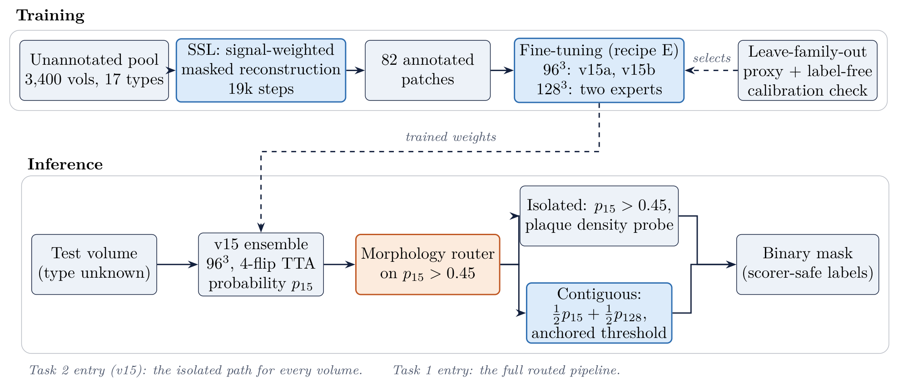

# Validating for the Unseen — SELMA3D 2026

Self-supervised 3D light-sheet microscopy segmentation with unseen-type model selection and foreground calibration.
Code, trained weights, paper and talk of team **Four and Furious** (Ayush Gupta, Harshita Gupta, Anushka Dixit)
for the [SELMA3D 2026 challenge](https://selma3d2026.grand-challenge.org/).



The challenge asks for one model that segments cells, plaques, nuclei, vessels and nerves in cleared-tissue
light-sheet volumes after self-supervised pretraining on 3,400 unannotated volumes (17 structure types) and
fine-tuning on only **82 annotated patches**. Most test volumes (17 of 26 in the preliminary phase) show structure
types that have **no annotated example**. Our solution:

1. **Signal-weighted masked reconstruction** pretraining — block masking in which structure voxels count 10× in the
   loss and half of the crops are centred on signal, so the network does not just learn to reproduce background.
2. **Recipe E** fine-tuning of a residual 3D U-Net (MONAI DynUNet, 16.7 M parameters), selected on a
   **leave-family-out proxy** (train without c-Fos cells and peripheral nerves, score exactly those).
3. **v15**: a two-model 96³ ensemble (v15a, v15b) — our Task 2 entry.
4. **Routed + anchored** (Task 1 entry): a morphology router sends contiguous-looking volumes to a 50/50 blend of v15
   with two 128³ experts, and the threshold is set per volume so the result contains as much foreground as v15
   (*foreground anchoring*).

## Final leaderboard

| Task | Entry | Final place | Mean position | Per-metric positions (isolated Dice / isolated PQ / contiguous Dice / contiguous clDice) |
|---|---|---|---|---|
| Task 2 — with SSL (open data) | v15 | **2nd** (tied) | 2.5 | — |
| Task 1 — with SSL (fixed data) | Routed + anchored | **5th** | 4.3 | 6 / 7 / 2 / 2 |

Final test phase of the SELMA3D 2026 challenge; entries are ranked by the mean of their positions over the four metrics.

## Results (mean ± s.d. over test volumes)

| Phase | Entry | isolated Dice | isolated PQ | contiguous Dice | contiguous clDice |
|---|---|---|---|---|---|
| Final test | v15 (Task 2) | 0.547 ± 0.262 | 0.360 ± 0.242 | 0.653 ± 0.155 | 0.737 ± 0.153 |
| Final test | Routed + anchored (Task 1) | 0.547 ± 0.262 | 0.360 ± 0.242 | 0.653 ± 0.155 | 0.738 ± 0.152 |
| Preliminary test (26 volumes) | v15 (Task 2) | 0.629 ± 0.160 | 0.453 ± 0.187 | 0.633 ± 0.130 | 0.747 ± 0.072 |
| Preliminary test (26 volumes) | Routed + anchored (Task 1) | 0.629 ± 0.160 | 0.453 ± 0.187 | 0.626 ± 0.128 | 0.730 ± 0.074 |

Isolated predictions of the two entries are identical by construction; routing changes contiguous volumes only.

## Key findings (details in the [paper](paper/SELMA3D_2026_paper.pdf))

- **Held-out accuracy did not predict the test score; a label-free foreground check did.** A held-out split of
  annotated volumes contains only seen structure types and preferred the weaker of our two best models. The amount of
  foreground a model predicts on *unlabelled* test volumes of unseen types, relative to a reference model, tracked the
  preliminary-test score (v11 ×1.19 → 0.537, v15 ×1.00 → 0.616, v17 ×0.75 → 0.573).
- **The late-training decline on unseen types is miscalibration, not forgetting.** Given the true amount of
  foreground, the fully trained model beats an early snapshot (0.432 vs 0.413), but its foreground drifts in opposite
  directions for tubes (×3.0) and cells (×0.6). Matching each volume's foreground to a better-calibrated model,
  without labels, recovers most of the loss (0.334 → 0.360).
- **Test-time self-training reverses sign with topology.** It improved clDice on 6/6 unseen nerve volumes and lowered
  PQ on 8/9 unseen cell volumes.
- **The remaining gap is recall of dim and small cells**: 39% of unseen c-Fos cells are touched by a prediction, found
  cells are predicted at about half their size.

## Repository layout

```
get_selma3d.py            download annotated data and the pretraining pool from the BioImage Archive
data/_filelists/          cached file lists (makes the 200-patches-per-type pool selection reproducible)
selma/                    data loading, preprocessing, SSL pretraining, fine-tuning, packaging
  prepare_all.py            build data/prep* from the annotated .mha files
  pretrain_ssl_v2.py        signal-weighted masked-reconstruction pretraining
  train_final.py            fine-tuning (recipe E), wall-clock-deadline schedule, EMA, resumable
  package.py                fp16 packaging of checkpoints + their inference settings
  holdout_*.json            data splits (9-volume held-out split, none, leave-family-out)
submission/               Grand Challenge container: inference.py, Dockerfile, route.json
scripts/                  reproduce.sh (all stages), train.sh (auto-resuming trainer), build_container.sh
tools/                    validation and analysis used in the paper (see below)
paper/                    LaTeX source, figures, figure scripts, compiled PDF
presentation/             slides (.pptx), talk script (PDF), deck generator
docs/results.md           all metric results in one place
```

## Setup

```bash
# Python 3.11; install the PyTorch build for your CUDA version first (https://pytorch.org)
pip install -r requirements.txt
```

The container needs Docker with GPU support; it is based on `pytorch/pytorch:2.9.1-cuda12.6-cudnn9-runtime`.

## Option A — build the containers from the released weights

Download `v15a.pt`, `v15b.pt`, `B128_all1.pt`, `B128_all2.pt` from the repository's release into `weights/`, then:

```bash
bash scripts/build_container.sh v15    weights/v15a.pt weights/v15b.pt                                  # Task 2 entry
bash scripts/build_container.sh routed weights/v15a.pt weights/v15b.pt -- weights/B128_all1.pt weights/B128_all2.pt  # Task 1 entry
```

Put one or more test `.mha` volumes into `submission/test/input/images/<interface>/` to have the script run the
container on them before saving `selma3d-<name>.tar.gz`.

## Option B — reproduce everything

```bash
bash scripts/reproduce.sh data        # ~110 GB: 82 annotated patches + 3,400 pretraining patches (seed 0)
bash scripts/reproduce.sh prepare     # data/prep, data/prep_raw
bash scripts/reproduce.sh ssl         # runs/ssl_v2/final.pt   (our run: 18,978 steps, ~3 h on an RTX 4060 Laptop)
bash scripts/reproduce.sh v15         # runs/v15a, runs/v15b   (4 h each on the laptop: 174 / 187 epochs)
bash scripts/reproduce.sh experts     # runs/B128_all1, runs/B128_all2  (~3 h each on an A100, ~50 epochs)
bash scripts/reproduce.sh containers  # both containers
```

Settings (all in `scripts/reproduce.sh`):

| Component | Setting |
|---|---|
| SSL | 96³ crops (50% centred on signal), 12³ block masks over 50–75%, structure voxels ×10 in a Huber loss, AdamW 3e-4 cosine, batch 2 |
| Network | DynUNet, 5 levels, filters 32/64/128/256/320, residual blocks, instance norm, deep supervision |
| Recipe E | per-volume z-score clipped to [−3, 25]; SGD Nesterov 0.99, lr 1e-2 poly (floor 2e-6, 1.5% warm-up); weight decay 3e-5; Dice + BCE; 33% foreground crops; uniform sampling over structure types; EMA 0.999; batch 2; 250 iterations/epoch |
| v15a / v15b | 96³; v15a holds out 9 volumes (`selma/holdout_v11.json`), v15b uses all 82 |
| Experts | 128³, all 82 volumes, same recipe and initialisation |
| Inference | Gaussian sliding window (overlap 0.5), 4-flip TTA for v15, threshold 0.45, components ≥ 4, plaque profile 0.30 / ≥ 8 |
| Routed entry | router on v15's mask (largest component ≥ 30% with ≤ 1,000 components, or size-weighted elongation ≥ 3); contiguous volumes: 0.5·v15 + 0.5·experts (single pass, to fit the T4 per-case time limit), threshold anchored so the foreground equals v15's (`submission/route.json`) |

Training is time-budgeted (`scripts/train.sh <run> <hours> <split> ...`): the learning-rate schedule follows wall-clock
progress to a deadline fixed at first launch, and relaunching the same command resumes after a crash.

## Validation and analysis tools

| Script | Purpose | Paper section |
|---|---|---|
| `tools/eval_lfo.py` | score a checkpoint on the withheld families (leave-family-out proxy) | 5, 6.4 |
| `tools/prelim_sanity.py`, `tools/prelim_route_check.py` | run the container code on unlabelled test volumes; routing decisions and foreground per structure type relative to v15 | 5, 6.3 |
| `tools/decide_final.py` | compare candidates by unseen-type foreground drift | 6.3 |
| `tools/tune_route.py` | blend / threshold / anchoring on held-out contiguous volumes | 6.3 |
| `tools/calib_lfo.py` | calibration drift: fixed vs. anchored vs. oracle thresholds across snapshots | 6.5 |
| `tools/ttt_lfo.py` | structure-conditional test-time self-training | 6.6 |
| `tools/router_mask_features.py`, `tools/router_cv.py` | router features and leave-one-structure-type-out validation | 4.5 |

`tools/prelim_*` expect the unlabelled preliminary-test volumes (distributed by the challenge on Grand Challenge) in
`data/prelim_test/{isolated,contiguous}_structures/`.

## Paper and talk

- Paper: [`paper/SELMA3D_2026_paper.pdf`](paper/SELMA3D_2026_paper.pdf) (LaTeX source in `paper/`; build with
  `pdflatex main && bibtex main && pdflatex main && pdflatex main`).
- Slides: [`presentation/SELMA3D_2026_presentation.pptx`](presentation/SELMA3D_2026_presentation.pptx) and
  [talk script](presentation/SELMA3D_2026_talk_script.pdf); regenerate with `node presentation/build_deck.js`
  (needs `npm install pptxgenjs`).

## Data

All data are the SELMA3D 2026 challenge data from the BioImage Archive, released under CC BY 4.0:
[S-BIAD2110](https://doi.org/10.6019/S-BIAD2110), [S-BIAD2106](https://doi.org/10.6019/S-BIAD2106) (annotated),
[S-BIAD3281](https://doi.org/10.6019/S-BIAD3281), [S-BIAD3277](https://doi.org/10.6019/S-BIAD3277) (unannotated).
Challenge description: [doi:10.5281/zenodo.19733195](https://doi.org/10.5281/zenodo.19733195).
Fine-tuning used only the 82 annotated patches; no pseudo-labels or external labelled data.

## Citation

If you use this code, please cite the challenge data and:

```bibtex
@misc{fourandfurious2026selma3d,
  title  = {Validating for the Unseen: Self-Supervised 3D Light-Sheet Microscopy Segmentation with
            Unseen-Type Model Selection and Foreground Calibration},
  author = {Gupta, Ayush and Gupta, Harshita and Dixit, Anushka},
  year   = {2026},
  note   = {SELMA3D 2026 challenge solution}
}
```
